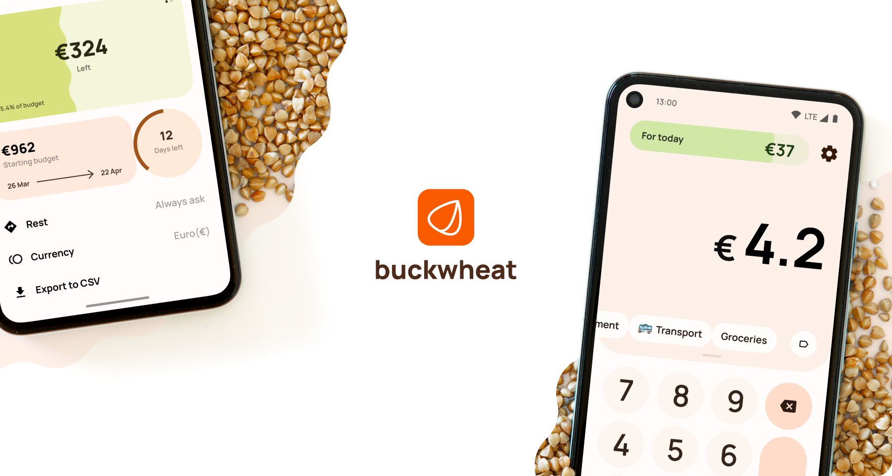

[](https://buckwheat.app/)

[![Latest release][release-badge]](https://github.com/danilkinkin/buckwheat/releases)
[![Crowdin localization][localization-badge]](https://translate.buckwheat.app)

[**Buckwheat**](https://buckwheat.app) is an app that helps you spend money wisely. 
Writing down each spending sobers the mind and gives you an idea of how much and how you can spend.

Are you going on a business trip or vacation? Buckwheat helps you save money during your trip.

[](https://play.google.com/store/apps/details?id=com.danilkinkin.buckwheat)
[](https://github.com/danilkinkin/buckwheat/releases)
[](https://apt.izzysoft.de/fdroid/index/apk/com.danilkinkin.buckwheat)
[](https://f-droid.org/packages/com.danilkinkin.buckwheat)

### Motivation

A couple of years ago, I used the [tzlvt](https://www.fuckgrechka.ru/tzlvt/) app. I liked his idea and it helped me learn how to manage money. After I decided to improve this idea and it inspired me to create buckwheat

### Building

Requirements: JDK 17 and an Android SDK with platform 37. Gradle itself is provided by the
wrapper, so no local Gradle installation is needed.

```bash
git clone https://github.com/danilkinkin/buckwheat.git
cd buckwheat
./gradlew assembleDebug
```

Run the same checks as CI:

```bash
./gradlew spotlessCheck lintDebug testDebugUnitTest
```

Debug builds are signed with the local debug keystore, so they install on any device:

```bash
adb install -r app/build/outputs/apk/debug/app-debug.apk
```

Release builds are **unsigned by default** (an unsigned APK cannot be installed - Android
rejects it with *"app not installed as package seems invalid"*). Two ways to get an
installable release build:

**1. Local testing** - sign with the debug key explicitly:

```bash
./gradlew assembleRelease -PsignWithDebugKey
```

Never publish an APK built this way.

**2. Distribution** - create a keystore once and keep it backed up:

```bash
keytool -genkeypair -v -keystore buckwheat-release.jks -alias buckwheat \
  -keyalg RSA -keysize 4096 -validity 10000
```

Then pass it through Gradle properties or environment variables (`RELEASE_STORE_FILE`,
`RELEASE_STORE_PASSWORD`, `RELEASE_KEY_ALIAS`, `RELEASE_KEY_PASSWORD`):

```bash
./gradlew assembleRelease \
  -PRELEASE_STORE_FILE=/path/to/keystore.jks \
  -PRELEASE_STORE_PASSWORD=... \
  -PRELEASE_KEY_ALIAS=... \
  -PRELEASE_KEY_PASSWORD=...
```

### Translations

If your language is missing or incomplete, please help to translate via [crowdin service](https://translate.buckwheat.app)

### Donate

If you want to support my work, you can share my app with friends or check another options on [special page](https://buckwheat.app/contribute)

### Other information

**Press Kit**: [Google Drive](https://drive.google.com/drive/folders/1DsVynLPhYvKJNIlFAz87GnK53ja3Suap?usp=sharing)

**Policy**: [You can read there](./POLICY.md)

**License**: [GNU GPL v3](LICENSE)

Developed by [Danil Зakhvatkin](https://github.com/danilkinkin) and [contributors](https://github.com/danilkinkin/buckwheat/graphs/contributors)

[comment]: <> (Images)
[release-badge]: https://img.shields.io/github/v/tag/danilkinkin/buckwheat?color=orange&label=release
[localization-badge]: https://badges.crowdin.net/buckwheat/localized.svg
